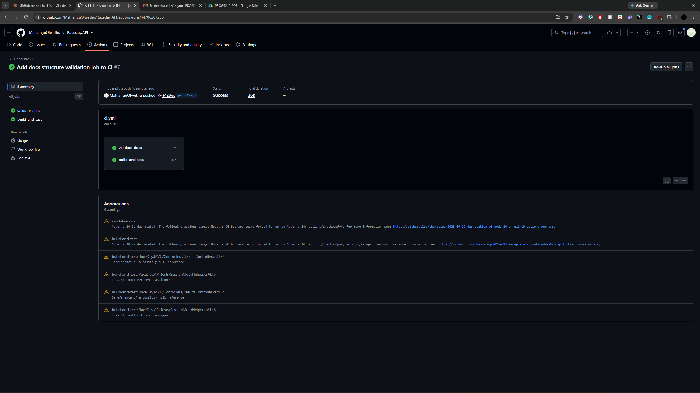

# RaceDay

RaceDay is a web-based event management system for South Africa's road running, walking and cycling community.
Organisers create events, categories and results; participants browse upcoming events, enter by choosing a
category and track their results.

| Part | Contents |
|---|---|
| 1 | ERD, API endpoint plan and SQL script in [`docs/`](docs) |
| 2 | ASP.NET Core Web API (`RaceDay.API`) with EF Core, session auth, Swagger and xUnit tests (`RaceDay.API.Tests`) |
| 3 | ASP.NET Core MVC app (`RaceDay.MVC`) that consumes the API, Azure Blob Storage, Docker |

## Video presentation

Unlisted YouTube video: https://youtu.be/8N_ivb0XRZo

## Roles

* **Organiser:** dashboard (events, enrolments per event, upcoming dates), create/edit/delete events with a banner image,
  manage categories, view and approve enrolments, capture results.
* **Participant:** register and log in, browse and filter upcoming events, view event details and enter by choosing a
  category, view enrolments (green Confirmed, amber Pending, red Cancelled), view results, update profile and picture.

Roles are enforced by the API (`[AuthorizeRole]`, 403 for the wrong role) and reflected in the MVC navigation.
The MVC app has no database or Azure access: all data and file uploads go through the API, which stores images in
Azure Blob Storage and saves their URLs.

## Run with Docker (one command)

```bash
docker compose up --build
```

* MVC app: <http://localhost:5000>
* API + Swagger: <http://localhost:5001/swagger>

This starts SQL Server, the API (it applies migrations on start-up) and the MVC app. Stop it with `docker compose down`.
Image uploads work straight away using **Azurite**, the local Azure Storage emulator, which also runs in Docker.
To use a real Azure Storage account instead, copy `.env.example` to `.env` and set `AZURE_STORAGE_CONNECTION_STRING`.

## Run locally

1. Set the Azure connection string for the API:
   `dotnet user-secrets set "AzureBlob:ConnectionString" "<connection string>" --project RaceDay.API`
2. Start the API (`https` profile, https://localhost:7082) and the MVC app, e.g. set both as startup projects in Visual Studio.
3. Run the tests with `dotnet test RaceDay.sln`.

## CI/CD

GitHub Actions ([`.github/workflows/ci.yml`](.github/workflows/ci.yml)) checks the required files, builds the
solution and the MVC project, and runs all unit tests on every push.



## Differences from the Part 1 plan

* `GET /api/events` accepts optional filters and `GET /api/events/mine` returns enrolment counts. Both were added for the
  Part 3 participant home page and organiser dashboard.
* Image upload endpoints return 503 with a friendly message if Azure Blob Storage is unavailable.

## AI tools disclosure

Claude (an AI assistant) was used to:

* correct my unit tests, which were not running;
* make the related code changes needed to get the application working;
* help write this README.

I reviewed and tested all of these changes myself.
